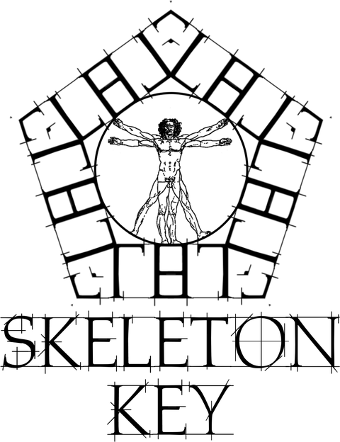

<p align="center">
  <picture>
    <source media="(prefers-color-scheme: dark)" srcset="images/logo-white.png">
    
  </picture>
</p>

# Skeleton Key

A posing and prop tool for Warhammer 40,000: Darktide.

Pose any character in the world, keep their poses as keyframes and sets, move, copy and place the props around them, and fly the camera anywhere.

**This is a beta.** Expect rough edges, and please report what you find.

## Install

1. Install the [Darktide Mod Framework](https://www.nexusmods.com/warhammer40kdarktide/mods/8).
2. Put this folder in your `mods` folder as `SkeletonKey`, so the path reads `mods/SkeletonKey/SkeletonKey.mod`.
3. Add `SkeletonKey` to `mods/mod_load_order.txt`.
4. In game, open the mod options and bind a key to Open Skeleton Key.

## Using it

Open the panel with your key.

Click a person to pose them. Each joint has three dials.

Click a prop to hold it in Object Key. Drag an arrow to slide it, and drag the ball to turn it.

Hold the right mouse button to fly the camera with WASD and the mouse. Shift doubles your speed and the wheel sets it.

Escape hides the panels, and a second Escape closes the tool and brings the camera home.

Hold K to see every key.

Your work is saved in `%APPDATA%\Fatshark\Darktide\SkeletonKey`, beside the game's own settings, so updating the mod never touches it.

## Spawning by path

On the Items page, type or paste a unit path into the box under Hold All and press Spawn or Enter.

It appears where the middle of your screen is looking, already held.

It only spawns if the level you are in has that unit loaded.

## For mod makers

Play a saved set on any unit:

```lua
local sk = get_mod("SkeletonKey")

sk.play_set(unit, "name", loop)
sk.stop_playing()
sk.is_playing()
```

Export a group of props from the Groups page, put the file in your mod, and place it with:

```lua
local group = mod:io_dofile("YourMod/your_file")
local units = group.place()
group.solid(mod, units)
group.remove(units)
```

`group.solid(mod, units)` makes the props block the player, even on servers you do not host. Pass your own mod object as `mod`. Leave the line out and they are decoration only.

The exported file needs nothing else, and Skeleton Key does not have to be installed for it to work.

## Contributing

Issues and pull requests are welcome.

There is no build step. The mod is plain Lua that the game loads as it is.

## Licence

Skeleton Key is free software under the GNU General Public License v3.0. You may use, change and share it, and anything you share that is built from it must stay open under the same licence. See [LICENSE](LICENSE).
